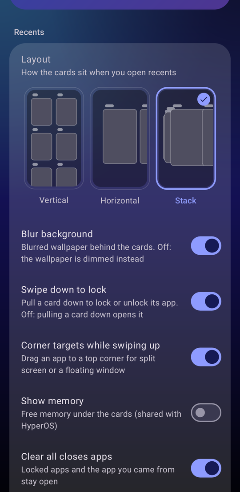
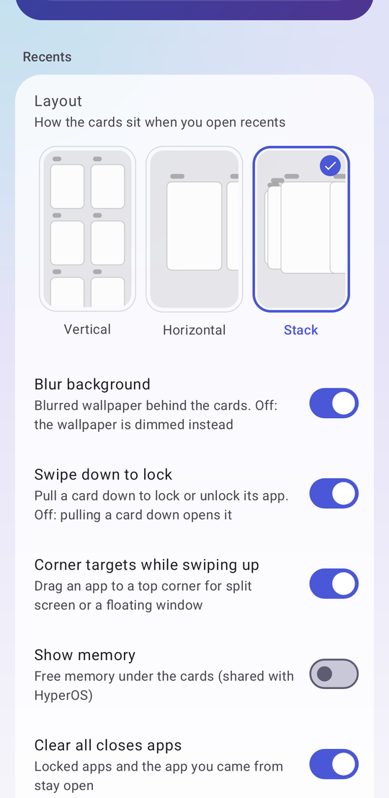
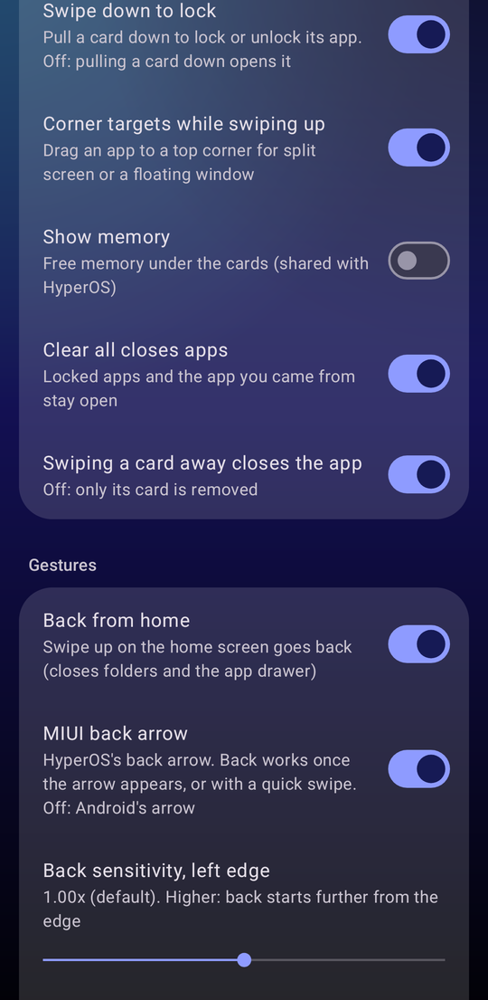
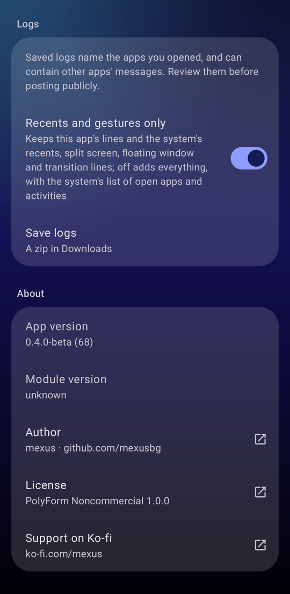
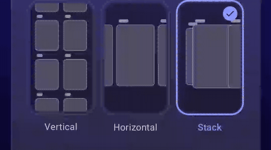

# HyperGestures

Stock-feeling HyperOS gestures and recents with the launcher you choose.

On HyperOS, full-screen gestures and the recents screen live inside MiuiHome, the system
launcher. Set Nova (or any other launcher) as home and HyperOS takes the gestures away or gives
you a broken recents screen. HyperGestures fixes that: your launcher stays home, and swipe up,
quick switch, recents and back work and look like stock HyperOS.

> **Beta.** Tested on the **Xiaomi 17 Ultra** with **HyperOS 4.0, EEA (Europe) firmware**. It
> may work on other HyperOS 4 phones and firmware too. If it doesn't, please
> [open an issue](../../issues) and attach your logs (see
> [Something not working?](#something-not-working)). It needs root and changes how SystemUI
> runs: read [Safety and recovery](#safety-and-recovery) before installing.

## Screenshots

| Recents layout, picked from live tiles | Light mode |
|---|---|
|  |  |

| Gestures | Logs and About |
|---|---|
|  |  |

## Features

- **Gestures with any launcher:** swipe up for home, swipe up and hold for recents, swipe along
  the bottom to switch apps, swipe in from an edge for back.
- **HyperOS recents, three layouts:** vertical (two-column grid), horizontal (one row) or
  stack (a deck), with MiuiHome's sizes and motion and frosted-glass blur.
- **Card actions as on HyperOS:** swipe a card up to close the app, pull it down to lock it,
  hold it for Lock, Split screen, Floating window and App info, tap the trash button to clear
  all (locked apps stay). MIUI's own vibrations for clearing and locking.
- **Split screen and floating windows on the way up:** while swiping up from an app, drag it to
  a top corner.
- **MIUI back arrow:** the HyperOS bulge and chevron, MiuiHome's rule for when a swipe counts as
  back, adjustable sensitivity for each edge.
- **Extras that work with any home app, MiuiHome included:**
  - hide the navigation line (the System launcher's own setting, or our alternative that keeps
    swipes and Circle to Search working);
  - Circle to Search on a long press of the navigation line, on or off;
  - App info that keeps its place when you open App permissions, as on stock MIUI;
  - real app icons in notifications instead of white squares (optional, needs LSPosed).
- **A status card that tells you what runs:** module, mount, recents provider, gestures and
  back, LSPosed hooks, and whether a reboot is pending.
- **Stays out of the way:** while MiuiHome is home, HyperGestures stands by at the next boot and
  HyperOS runs as stock.
- **Battery first:** no polling, nothing running while idle.

## Requirements

- **Phone:** tested on the Xiaomi 17 Ultra (`nezha`), HyperOS 4.0 EEA firmware (Android 17).
  Other HyperOS 4 phones and firmware may work: on firmware it wasn't built for, the module
  still sets up and tells you so, and if gestures don't come up at boot it rolls back to stock
  on its own.
- **Root:** KernelSU, with a module mount (a metamodule such as Hybrid Mount works).
- **Home:** a third-party launcher set as the default home app.
- **Optional:** LSPosed, for the notification icon fix.

## Install

1. In HyperOS, keep the navigation line visible in the System launcher's settings. To hide it,
   use HyperGestures' own setting instead.
2. Set your launcher as the default home app.
3. Download `HyperGestures-<version>.zip` from [Releases](../../releases), install it in KernelSU
   and **reboot fully** (not a soft reboot).
4. For the notification icon fix: in LSPosed, enable **HyperGestures notification icons** for
   System UI and AOD, turn on **Fix notification icons** in HyperGestures' settings, and reboot.

To update, install the new zip over the old one and reboot.

## How to use

- **Settings:** open **HyperGestures** from your app list. The card at the top shows whether it
  is running and what needs a reboot. Every switch applies at once unless it says otherwise.
- **Recents layout:** tap the Vertical, Horizontal or Stack tile under Recents. The next time
  you open recents, it uses that layout.
- **In recents:**
  - swipe a card up: close the app;
  - pull a card down: lock or unlock it (locked apps survive Clear all);
  - hold a card: Lock, Split screen, Floating window, App info;
  - tap the trash button: clear all;
  - turn on **Show memory** in settings for HyperOS's free-memory line under the cards.
- **While swiping up from an app:** drag it to a top corner for split screen or a floating
  window.
- **Back:** swipe in from the left or right edge. Set each edge's sensitivity under Gestures,
  and pick the MIUI or the Android arrow.
- **Status in KernelSU:** the module's Action button prints a status summary.

## Switching home apps

- **From the System launcher (MiuiHome) to another launcher:** reboot after the switch. While
  MiuiHome is home, HyperGestures stands by and turns on at the next boot.
- **Between third-party launchers:** switch any time, no reboot needed.
- **Back to the System launcher:** the app tells you to reboot. After the reboot HyperGestures
  stands by and HyperOS runs its own gestures.

## Something not working?

Please [open an issue](../../issues) with:

1. your phone model and HyperOS version (Settings, About phone, OS version, for example
   `4.0.0.13.XPAEUXM`);
2. the HyperGestures version (Settings, About);
3. what you did, what you expected and what happened;
4. **the logs:** in HyperGestures' settings, under Logs, tap **Save logs**. A zip appears in
   Downloads; attach it to the issue. Saved logs name the apps you opened and can contain other
   apps' messages, so look through them before posting publicly.

A screen recording helps a lot for anything that looks or moves wrong.

## Safety and recovery

HyperGestures checks itself at every boot. If the gesture provider doesn't come up, SystemUI
crash loops, or boot doesn't complete three times in a row, it rolls back on its own: it gives
home back to MiuiHome, restores the navigation mode and disables itself.

To remove it cleanly:

1. While the phone is up, run
   `adb shell su -c sh /data/adb/modules/hypergestures/restore.sh`.
2. Uninstall the module in KernelSU and reboot.

If the screen has no working navigation, use adb: run `restore.sh` as above, or disable the
module with `adb shell su -c touch /data/adb/modules/hypergestures/disable` and reboot. KernelSU
safe mode also boots without the module.

Before a firmware update (OTA), the safest route is to run `restore.sh` and disable the module,
update, then install a HyperGestures build for the new firmware. Small OTAs often keep working,
but Xiaomi may change SystemUI internals HyperGestures depends on.

## Building from source

See [BUILDING.md](BUILDING.md).

## Support

If HyperGestures is useful to you, you can support it at [ko-fi.com/mexus](https://ko-fi.com/mexus).

## License

HyperGestures is Copyright (c) 2026 [mexus](https://github.com/mexusbg) and licensed under the
[PolyForm Noncommercial License 1.0.0](https://polyformproject.org/licenses/noncommercial/1.0.0)
(full text in [LICENSE](LICENSE)). You may use, share and change it for any noncommercial
purpose; no commercial use. Whoever passes it on must pass on the license and its
`Required Notice:` line. The vendored AOSP sources under `aosp/`, the libxposed API stubs and a
few other files stay under the Apache License 2.0 ([LICENSE-APACHE-2.0](LICENSE-APACHE-2.0)).
[NOTICE](NOTICE) lists which parts are under which license, and the credits.

Xiaomi, MIUI, HyperOS and MiuiHome are trademarks of Xiaomi. HyperGestures is not affiliated
with or endorsed by Xiaomi.
